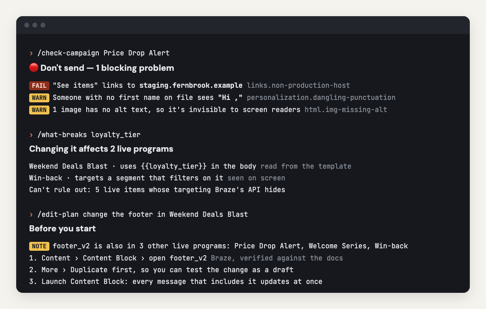

# crm-lifecycle-ops

**The AI copilot for lifecycle and CRM operations on Braze, Klaviyo and Iterable.**
Ship campaigns faster. Break nothing that's live.

[](https://github.com/har5h98/crm-lifecycle-ops/actions/workflows/ci.yml)
[](https://github.com/har5h98/crm-lifecycle-ops/releases)


<p align="center"></p>

A Claude Code plugin for lifecycle, CRM and marketing-ops teams who build campaigns by hand.
It knows your live account and your team's rules. It is **read-only**: it never sends or edits anything.

## What it does

| | | Try |
|---|---|---|
| **Plan and build faster** | Click-by-click build steps in your platform's terms, with your naming and UTMs | `/build-plan` |
| **Change safely** | See what a change to a segment, field or shared block will break, before you make it | `/what-breaks` |
| **Send with confidence** | Every message on every channel, checked as every kind of customer | `/check-campaign` |
| **Prove the impact** | Delivery health after launch, plus problems caught and hours saved | `/ops-report` |

## Quick start

Needs [Claude Code](https://claude.com/claude-code) and Node.js 20+.

```
/plugin marketplace add har5h98/crm-lifecycle-ops
/plugin install crm-lifecycle-ops@crm-lifecycle-ops
```

Then try it on the built-in demo account. No platform access needed:

1. `/refresh demo` loads a fictional brand's Braze workspace.
2. `/check-campaign Price Drop Alert` checks a whole campaign.
3. `/what-breaks loyalty_tier` shows what a change would affect.

When you're ready for your own account:

- `/setup` teaches it your team's rules (about five minutes, or paste an email you like and it learns from that).
- `/connect` adds a read-only key. Keys go in the plugin's settings and your system's secure storage, never in chat.

<details>
<summary><b>Using Cursor, Claude Desktop or another MCP client?</b></summary>

The engine is also on npm, so any MCP client can run it. The slash commands are Claude Code skills, so
elsewhere you ask in plain words ("check this email", "what breaks if I rename loyalty_tier?").

```json
{
  "mcpServers": {
    "crm-lifecycle-ops": {
      "command": "npx",
      "args": ["-y", "crm-lifecycle-ops"],
      "env": { "CLO_BRAZE_API_KEY": "…", "CLO_BRAZE_REST_ENDPOINT": "https://rest.iad-01.braze.com" }
    }
  }
}
```

Leave `env` out to use the demo account. Every setting is listed in [`server.json`](server.json).

</details>

> **Early alpha.** Everything works on the demo account and against mocked API responses. It hasn't been
> field-tested on real accounts yet. If a result looks wrong, `/report-problem` turns it into a test and a fix.

## Example

Real output from the demo account:

```
/check-campaign Price Drop Alert          🔴 Don't send. 1 blocking problem

fail  links.non-production-host        "See items" points at staging.fernbrook.example
warn  personalization.dangling-punct.  Someone with no first name on file sees "Hi ,"
warn  links.utm-inconsistent           1 of 2 links carry UTM tags; "Help" doesn't
warn  html.img-missing-alt             1 image has no alt text

/check-sms Flash Sale Text                🟡 Fix before sending

warn  sms.unicode            "’" and "—" switch the text to Unicode: 70 characters per segment, not 160.
                             Swap ’ → ' and — → -
warn  sms.too-many-segments  Up to 3 billed segments; house limit is 2
warn  sms.no-opt-out         No "Reply STOP to opt out"
```

**Code makes every pass/fail call, never AI.** Claude adds a labelled, advisory review (subject line, CTA, tone)
on top.

## All commands

✅ works fully today · 🧪 works on the demo account and mocked APIs, not yet field-tested on real accounts

| | Command | What it does | Status |
|---|---|---|---|
| **Get started** | `/start-here` | Overview and the best first step | ✅ |
| | `/setup` | Teach it your team's rules: language, brand, links, footer, senders, test customers, strictness | ✅ |
| | `/house-rules` | View or change those rules; mark a finding "fine for us" | ✅ |
| | `/connect` | Connect Braze, Klaviyo or Iterable with a read-only key | 🧪 |
| | `/refresh` | Pull the latest campaigns, journeys, segments, templates and content blocks (or load the demo) | 🧪 |
| **Plan and build** | `/plan-journey` | Design a journey and check it for overlap with what's already live | 🧪 |
| | `/build-plan` | Step-by-step build instructions in your platform's own terms | 🧪 |
| | `/bulk-edit` | Preview a find-and-replace across every subject, body and content block | 🧪 |
| **Change safely** | `/what-breaks` | What's affected if you change or delete an attribute, segment, block, event or link | 🧪 |
| | `/what-changed` | What changed in the account since last time, live items first | 🧪 |
| | `/edit-plan` | The safe way to change something live (copy, running journeys, shared blocks, audiences) | 🧪 |
| | `/show-journey` | Draw a live journey as a diagram, with structural problems flagged | 🧪 |
| **Send with confidence** | `/check-campaign` | A whole campaign or journey: every message, settings and structure | 🧪 |
| | `/check-email` | One email: HTML, links, unsubscribe, UTMs, personalization, house rules | ✅ |
| | `/check-push` | One push: lock-screen length for your longest names, deep links, blanks | ✅ |
| | `/check-sms` | One text: billed segments, Unicode traps, opt-out wording, sender name | ✅ |
| | `/check-in-app` | One in-app message or content card: length, buttons, links | ✅ |
| **Prove the impact** | `/watch-launch` | Bounce, unsubscribe, spam and delivery rates against thresholds | 🧪 |
| | `/ops-report` | Messages checked, problems caught, hours saved, for you or the whole team | ✅ |
| | `/report-problem` | Report a wrong result; it becomes a test case and gets fixed | ✅ |

## Details

<details>
<summary><b>What "check" covers, by channel</b></summary>

| Channel | Catches |
|---|---|
| **Email** | Broken Outlook blocks, unclosed tables, missing alt text, Gmail clipping, missing preheader; staging or malformed links, `http://`, inconsistent UTMs, broken pages (live check); missing unsubscribe (skipped for transactional mail) |
| **Push** | Title and body length for your *longest* customer names, line breaks that hide titles on iOS, deep links, Android's required title (Braze) |
| **SMS** | Billed segments the way carriers count them, the exact character that switches a text to Unicode, opt-out wording, sender name, each platform's limits |
| **In-app** | Body length, buttons and their links, click-through destination, HTML structure |
| **Content cards** | Title and message length, card link and image destinations |
| **Webhooks** | Missing or staging URLs, keys written into the URL, JSON bodies that break when a name contains a quote |
| **Personalization** (all) | Renders every message for a *complete*, *empty*, *long-values* and *accented-name* customer (or your own): `Hi ,` blanks, literal `null`, leftover `{{ }}`, template errors, Iterable comparisons that silently skip the send |
| **Campaigns & journeys** | Audience and conversion event, naming convention, dead-end branches, unreachable steps, empty message steps |

Braze Liquid, Klaviyo's template language and Iterable Handlebars are supported. Platform tags that can't run
locally (coupon codes, catalog lookups, Connected Content) are reported as *not verified*, never as passing or
failing. Full list with ids: [`src/checks/catalog.ts`](src/checks/catalog.ts).

</details>

<details>
<summary><b>Your rules, not just ours</b></summary>

What's "wrong" depends on the team, so checks come in three layers:

| Layer | Examples | Can a team change it? |
|---|---|---|
| **Locked**: wrong for everyone | No unsubscribe, template syntax that doesn't render, broken links | No |
| **Defaults**: sensible everywhere | Missing alt text, `http://` links, Gmail clipping, mixed UTM tagging | Re-grade or turn off |
| **House rules**: your conventions | Spelling, date format, brand terms, banned phrases, approved domains and senders, UTM naming, footer, subject length, name fallback, naming convention, test customers | Set in `/setup` |

"That's fine for us" becomes a recorded exception with a reason (`/house-rules`), which is different from
"the tool is wrong" (`/report-problem`). Teams share one rulebook by setting the same **Shared rules file** in the plugin's settings.

</details>

<details>
<summary><b>What it can't see (yet)</b></summary>

Every result says what it couldn't verify, and every dependency says how it's known (*confirmed by the API*,
*read from the template*, *read from the segment description*, *seen on screen*).

- **Local rendering is an approximation.** Braze Connected Content and catalog lookups aren't executed, and
  Klaviyo's template language is approximated. These are reported as *not verified*.
- **Braze's API doesn't say which segment a campaign or Canvas targets.** `/what-breaks` lists those as
  "can't rule out" and can read them from your Braze dashboard via Claude in Chrome, with your OK.
- **Iterable's API doesn't return journey step order**, so Iterable journeys show their emails but not the path.
- **Braze content cards** come back from the API with few fields; card checks are fullest when the copy is pasted.
- **It never builds or edits in your account.** `/build-plan` and `/edit-plan` tell you how; `/bulk-edit` previews only.

</details>

## What it runs, sends and fetches

It never sends messages, never edits your account, never reads customer profiles (it tests with made-up
customers), and sends nothing to the author or any third party.

| What | When | Where it goes |
|---|---|---|
| A local MCP server (`node dist/mcp-server.js`, readable source in `src/`) | When Claude Code loads the plugin | Your machine only |
| Read-only API calls | `/refresh`, `/watch-launch` | Only the platform you connected: your Braze REST endpoint, `a.klaviyo.com`, or `api.iterable.com` / `api.eu.iterable.com` |
| Link checks (unsubscribe and tracking links are never requested) | Only when you ask for a live link check | The links in the email being checked |
| Local files: snapshots, house rules, a usage log of check ids and counts | Normal use | `~/.crm-lifecycle-ops/` |
| A copy of the usage log (counts only, never message content) | Only if you set a team report folder | The folder you chose |
| A GitHub issue | Only via `/report-problem`, after you approve the exact text | `github.com/har5h98/crm-lifecycle-ops` |

API keys are read only from the plugin's settings (secure storage). See [SECURITY.md](SECURITY.md) and the
[privacy policy](PRIVACY.md).

## Learn more

- [Operator guide](docs/operator-guide.md): a one-page routine for setup, each step of a build, and the weekly review.
- [How it works](docs/how-it-works.md): the architecture, data flow and design decisions in plain language.

## How it gets better

1. **You report:** `/report-problem` turns a wrong result into a redacted GitHub issue (it asks before posting).
2. **It becomes a test:** each confirmed report joins [`tests/corpus/`](tests/corpus) and must pass from then on.
3. **Fixes are drafted automatically:** Claude writes the test and the fix as a pull request for human review.
4. **Vendor changes are watched:** a weekly job checks the Braze, Klaviyo and Iterable APIs for changes.

Wrong results are the most valuable contribution. See [CONTRIBUTING.md](CONTRIBUTING.md).

## License

MIT. Not affiliated with or endorsed by Braze, Klaviyo or Iterable; product names are trademarks of their owners.
